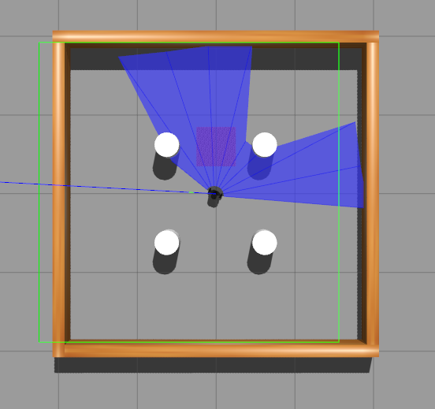

# ddpg_env

DDPG agent that drives a TurtleBot3 burger to goals in Gazebo, using lidar, goal distance and goal heading as input.

This branch is a port to **ROS 2 Jazzy + Gazebo Harmonic + PyTorch**. The original ROS 1 / TF1 code is in [legacy/](legacy/). It was based on [turtlebot3_machine_learning](https://github.com/ROBOTIS-GIT/turtlebot3_machine_learning); the port uses the same stage worlds and goal sampling, but resets by teleporting the robot and goal (about 0.1 s instead of about 2 s for delete and respawn).

<p align="center">
  
  <br>Turtlebot with simulated lidar lines (original version).
</p>

## Requirements

- ROS 2 Jazzy with `ros-jazzy-turtlebot3`, `ros-jazzy-turtlebot3-simulations` (includes `ros_gz`)
- PyTorch in the active Python environment (ROCm or CUDA build for GPU; CPU works too, the networks are small)
- numpy < 2 (ROS Jazzy's Python packages are built against numpy 1.x)

## Build

Build **without** `--symlink-install`, so the `train` script runs on the active (venv) `python3` rather than `/usr/bin/python3`. Rebuild after editing code.

```bash
cd ~/ros2_ws/turtlebot3_ws
colcon build --packages-select ddpg_env
source install/setup.bash
```

## Train

```bash
# terminal 1: world + robot + goal marker, running as fast as possible (about 37x real time headless)
ros2 launch ddpg_env stage.launch.py stage:=1 gui:=false

# terminal 2: agent (pass -p stage:=N to match a different stage)
ros2 run ddpg_env train --ros-args --params-file src/ddpg_env/config/steer.yaml
```

Launch options:

| arg | default | |
|---|---|---|
| `gui` | `true` | Gazebo window. Turn it off for speed; turn it on (maybe with `rtf:=1.0`) to watch a policy |
| `rtf` | `0` | target real-time factor; `0` = as fast as the CPU allows |
| `physics_step` | `0.004` | seconds per physics step (stock world: `0.001`, which caps out at about 10x real time) |
| `solver_iters` | `50` | ODE solver iterations (stock: `150`) |

Driving a fixed command sequence gives the same trajectory with `0.004`/`50` as with the stock physics. At `0.008`/`30` the trajectory also matches at 1x, but the sim can run hundreds of times real time, much faster than the agent can keep up with.

If the log reports `late steps`, the agent isn't keeping up with the sim (each step should be one 0.2 s lidar scan of sim time); set `rtf` to a fixed value such as `20.0`. One late step when gradient updates start is normal.

Each run writes to `~/ros2_ws/ddpg_runs/<algo>_<mode>_<timestamp>/`: `episodes.csv`, `config.json`, `latest.pt` (every 10 episodes and on exit), `best.pt` (best rolling-average goals per episode).

```bash
ros2 run ddpg_env plot ~/ros2_ws/ddpg_runs/<run>     # writes progress.png
```

### Early stopping

Training stops on its own once it plateaus. That happens when the 50-episode rolling average of goals per episode hasn't risen by at least max(0.1, 5%) in 150 episodes. The check only runs once exploration noise has finished decaying (`noise_decay_steps`) and at least 150 episodes have run, so the measured performance reflects the near-final policy. `episodes` is just an upper limit. Tune it with the `plateau_*` parameters; `-p plateau_patience:=0` disables it.

## Test a trained policy

```bash
ros2 run ddpg_env train --ros-args --params-file src/ddpg_env/config/steer.yaml \
  -p train:=false -p checkpoint:=$HOME/ros2_ws/ddpg_runs/<run>/best.pt
```

## Algorithms

`-p algo:=ddpg` (default) or `-p algo:=td3`. TD3 adds twin critics (the TD target uses the smaller Q), clipped noise on target actions, and delayed actor updates (`policy_delay`, `target_noise`, `target_noise_clip`). It's usually more stable than DDPG, especially with more than one action. Runs are named `<algo>_<mode>_<timestamp>`. A checkpoint from either algorithm can be loaded for testing; resuming training needs the same `algo`.

## Modes

| config | actions | |
|---|---|---|
| `config/steer.yaml` | angular velocity, fixed 0.15 m/s forward | sanity check: start here |
| `config/steer_speed.yaml` | linear (0 to 0.22 m/s) + angular | full problem |

All parameters and defaults are in `DEFAULTS` in [ddpg_env/train.py](ddpg_env/train.py). Override any of them with `-p name:=value`.

## Stages

Pass the same stage to both the launch (`stage:=N`) and the trainer (`-p stage:=N`). The trainer uses it for goal sampling.

| stage | world | notes |
|---|---|---|
| 1 | empty arena | |
| 2 | 4 static pillars at (±1, ±1) | goals are kept 0.5 m from pillars; the launch makes the pillars static (the stock model isn't, which slows the sim about 20x) |
| 3 | the same pillars, rotating | pillars must stay dynamic, so this stage is slower |
| 4 | inner walls + 2 moving obstacles | goals come from a fixed list |

To start a harder stage from an easier one's policy: `-p checkpoint:=<stage 1 run>/best.pt`.

## Results (stage 1)

| run | best 50-episode avg goals/ep | notes |
|---|---|---|
| DDPG, `steer` | 5.9 | converged in about 220 episodes (8.5 min) |
| DDPG, `steer_speed` | 0 to 5 | seed-dependent: one run reached about 5, another collapsed to spinning in place as Q diverged (270+, true value about 0) |
| TD3, `steer_speed` | 8.5 | 482 episodes (19 min, plateau stop); Q settled at about 95 |

DDPG's critic overestimates Q, and with two actions the actor found a "spin in place" policy the critic overrated. TD3's twin critics and target smoothing fixed it. Use `algo:=td3` for `steer_speed`.

## Safeguards

Two sims on the same `ROS_DOMAIN_ID` interleave their scans and odometry and both obey `cmd_vel`, which silently wrecks a run. The trainer checks for more than one `/scan` publisher at every reset. It also checks that the robot is clear after each reset teleport, retrying up to 3 times. Either failure stops the run with an error and saves `latest.pt`. To run a second sim alongside, give it its own `ROS_DOMAIN_ID` and `GZ_PARTITION`.

## Changes from the original

The original tended to slow to a crawl during training. Fixed in this port:

- **Progress reward after a goal / reset.** `past_distance` now resets to the new goal's distance, so reaching a goal is no longer followed by a large negative reward.
- **Time penalty per step.** Progress reward alone sums to the same total at any speed, so slow driving was optimal.
- **No bootstrapping through terminals.** Collision and goal transitions use `target = reward`; timeouts still bootstrap (they're truncations, not terminals).
- **Actor output init.** Small uniform init on the output layers (as in the DDPG paper), `tanh` outputs mapped to velocities (no saturating sigmoid), inputs scaled to about [-1, 1].
- **Target networks** start as copies of the main networks.
- **Previous action** is actually fed back into the state.
- **Exploration:** Gaussian noise on both actions (both signs), decaying linearly by step, plus uniform-random warmup steps.
- **Actions are clipped** to [-1, 1] before being stored and applied.
- **Starts fresh** by default; resume with `-p checkpoint:=...`.
- **Speed:** persistent subscribers, networks stay on the GPU, the gradient update runs while the sim advances to the next scan, teleport resets, and lighter physics settings. About 185 steps/s (37x real time), compared with about 5 steps/s for the original.
